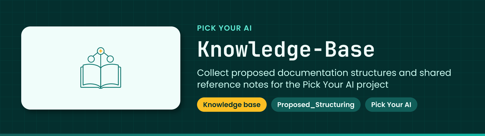

<!-- showcase:banner:start -->

  

<!-- showcase:banner:end -->

<!-- showcase:nav:start -->
**Pick Your AI** · [All repositories](https://github.com/Pick-Your-AI) · [Contributing](https://github.com/Pick-Your-AI/.github/blob/main/CONTRIBUTING.md) · [Security](https://github.com/Pick-Your-AI/.github/blob/main/SECURITY.md)
<!-- showcase:nav:end -->

# Knowledge-Base

<!-- showcase:badges:start -->

<!-- showcase:badges:end -->

<!-- showcase:tagline:start -->
**Collect proposed documentation structures and shared reference notes for the Pick Your AI project.**
<!-- showcase:tagline:end -->

---
